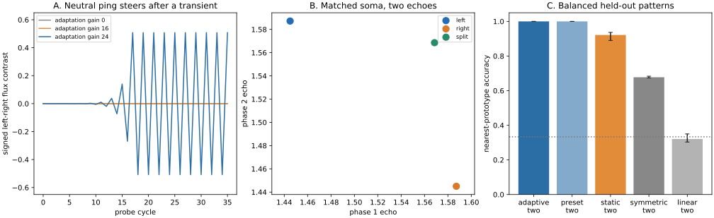
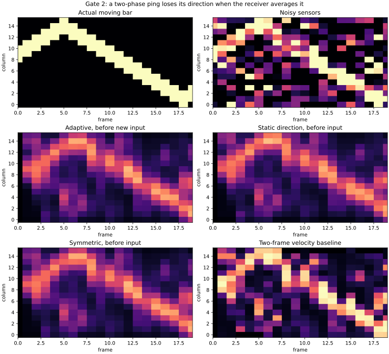

# SihtiBrainV3 — a ping that changes where it looks

An intentionally small experiment on whether a **scalar somatic pulse** can
sample distinct hidden branches over successive cycles. A seven-compartment
leaky reciprocal cable has a soma, two branch roots, and four leaves. Three
leaf patterns have exactly the same passive somatic voltage. Each ping changes
a short-lived branch adaptation trace; the trace changes the next ping's cable
conductances. A separate local state gate lets hidden branch voltage alter
the cable seen by the ping.



## Run

```bash
python -m pip install -r requirements.txt
python -m unittest discover -s tests -v
python demo.py --output runs/gate1 --trials 300
```

The demo writes `metrics.json`, `gate1.svg`, and `gate1.png`. The checked-in
figure and metrics in `docs/` came from this command. No training, GPU or
external dataset is needed. Requires Python 3.10+.

## Gate 1 result

After 36 identical neutral pings with a seeded adaptation imbalance of
`10⁻⁶`, the last cycles alternate left/right with a median normalized flux
contrast of **0.508**. This requires a steep adaptation gain (`β=24`) and
conductance clipping (`0.162` to `3.962`); at `β=16`, the imbalance barely
grows over the same run. Exact initial symmetry stays symmetric.

Two consecutive probe gates sampled three patterns with the same passive
soma voltage (`1.565174859...`). On four independent noise seeds of 300
balanced cases each, nearest-prototype accuracy was:

| Readout | Mean accuracy | What it tests |
|---|---:|---|
| Adaptive two phases | 100% | Endogenous complementary gates |
| Preset two phases | 100% | The same gates externally scheduled |
| Same asymmetric gate twice | 92.2% | Two reads, one direction |
| Same symmetric state gate twice | 67.8% | Left/right symmetry remains |
| Alternating linear cable | 32.1% | No input-dependent operator |

Balanced Gaussian leaf-current noise has standard deviation `0.05`, then is
zero-sum adjusted so the passive soma **remains exactly matched**. Each soma
echo gets independent Gaussian read noise of `0.01`. Gate calibration and
class prototypes use the three noiseless patterns; no learned decoder is fit
to noisy cases. Detailed protocol, signatures and caveats: [Gate 1](docs/GATE1.md).

This is a causal toy about **observability through a time-varying operator**.
It does not show that adaptation is required (the preset control ties), that
a backpropagating action potential has these conductances, that the model
segments images, or that transformer J-space is dendritic nullspace.

V3 is separate from [SihtiBrain](https://github.com/anttiluode/SihtiBrain)
and [SihtiBrainV2](https://github.com/anttiluode/SihtiBrainV2). Neither repo
is modified here.

## Gate 2: a moving bar and the lost phase

The [16-column causal movie test](docs/GATE2.md) sends each column's two
branch-weighted pings to its neighbors **one frame later**. Each column
reads a local three-location patch through the same seven-node passive
cable. The receiver averages the two pulse phases before it updates.



```bash
python demo_tracker.py --output runs/tracker
```

On 32 fixed noisy movies, next-frame top-three bar recall is **0.615** for
the adaptive schedule. It is **exactly 0.615** for both an externally preset
schedule and a symmetric two-pulse neighbor route. A simple two-frame
velocity forecast reaches **0.781**. The adaptive and symmetric prior maps
differ by at most `3.3e-16` because averaging mirrored phases cancels their
direction. This gate **fails** to show a tracking advantage for the ping.

The next falsifiable question is whether a phase-aware downstream receiver
can retain the directional information and learn a useful motion rule under
the same causal inputs and pulse budget. This gate has no slow conductance
write or self-updating object basin.
